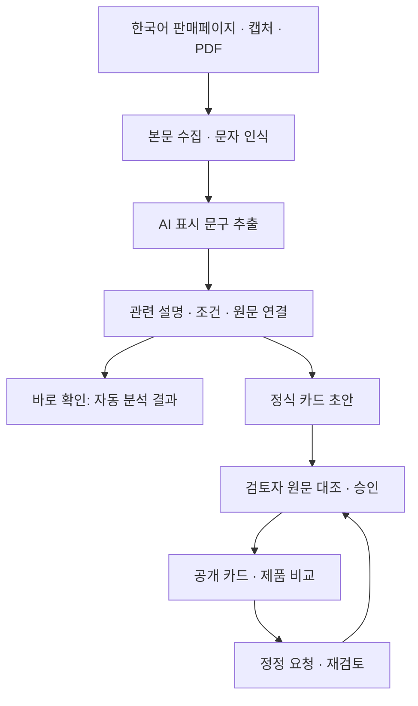

# AI 정보카드

### 구매 전, AI 기능의 근거와 사용 조건을 확인하는 소비자 정보 서비스

한국어 판매페이지 주소나 캡처·PDF에서 **‘AI’ 표시 문구와 관련 설명·사용 조건을 찾아 원문에 연결**합니다. 같은 품목의 두 제품을 공통 질문으로 비교하고, 검토자가 확인한 카드의 출처와 승인 기록을 살펴볼 수 있습니다.

**[서비스 열기](https://ai-infocard.co.kr/) · [주소·이미지로 확인](https://ai-infocard.co.kr/check) · [제품 비교](https://ai-infocard.co.kr/compare) · [설계·검증 근거](https://ai-infocard.co.kr/about)**

2026 AI 라이프 솔루션 챌린지 출품작. 아이디어 챌린지 수상 대상 후보작 「소비자 친화 AI 정보카드」를 제안자 본인이 구현했습니다.

## 무엇을 할 수 있나요?

| 기능 | 이용 흐름 |
|---|---|
| **판매페이지 바로 확인** | 주소를 입력하면 본문·이미지에서 읽은 AI 문구와 관련 설명·조건을 보여 줍니다. |
| **이미지·PDF 분석** | 상세페이지 캡처 여러 장과 PDF를 함께 입력할 수 있습니다. 긴 이미지는 나누어 읽습니다. |
| **공개 제품 카드 탐색** | 제품명·브랜드로 기존 카드를 찾고, 원문과 검토 내용을 확인합니다. |
| **공통 질문별 제품 비교** | 같은 품목의 두 제품을 조건·데이터·해제·안전·피해구제 관점에서 나란히 확인합니다. |
| **검토·승인·정정** | 자동 초안을 검토자가 원문과 대조한 뒤 공개하고, 공개 이후에도 확인·정정 요청을 받습니다. |
| **읽기 지원** | 쉬운 말·큰 글씨·읽어주기와 색상·문자 범례를 제공합니다. |

**바로 확인은 자동 분석 결과, 공개 카드는 검토자가 승인한 결과입니다.** 공개자료에서 설명을 찾지 못한 경우와 제품에 기능이 없는 경우를 구분하며, 제품의 우열·진위·법 위반 여부는 판정하지 않습니다.

## 어떻게 구현했나요?



| 역할 | 구현 |
|---|---|
| **AI·문자 인식** | 외부 모델을 통한 이미지·스캔 PDF 문자 인식, 설정에 따른 문구 선별·연결. 모델 공급자와 규칙 모드를 분리합니다. |
| **검색·연결 규칙** | 한국어 문자 2-gram BM25로 근거 후보를 찾고, 인용 일치·근거 번호·사용 조건을 검사합니다. |
| **자료 수집 보완** | 본문·렌더링된 페이지·상세 이미지 수집 경로와 OCR을 연결하고, 확보한 자료의 범위에 맞춰 결과를 구성합니다. |
| **사람의 검토** | 검토자가 원문·조건·공공 DB 조회 내용을 확인하고 공개를 승인합니다. 자동 분석만으로 정식 카드를 공개하지 않습니다. |

별도 대형 모델을 자체 학습한 서비스가 아니라, **기존 AI 모델·OCR·근거 검색·연결 규칙·검토 절차를 결합한 구현**입니다. 쇼핑몰의 자동 접속 제한이나 자료 해상도에 따라 수집 범위가 달라질 수 있으며, 캡처·PDF 입력 또는 확인 요청으로 이어갈 수 있습니다.

**기술 구성:** Python · FastAPI · Jinja2 · SQLite · BM25 · PyMuPDF · Pillow · Playwright · 외부 AI 모델 · Render

## 개발·검증 결과

| 구분 | 기록된 결과 | 해석 범위 |
|---|---|---|
| **공개 카드** | 228장 · 27개 품목 | 아래 기존 집계 기준. 최신 수치는 서비스에서 확인합니다. |
| **개발자료 조건 표시** | **70.8% → 95.8%** (34/48 → 46/48) | 같은 48문구·기준 답안·저장된 AI 응답을 고정한 코드 보완 전후 비교입니다. |
| **별도 제공 라벨 대조** | 근거상태 **82.8%** (48/58), 조건표시 **89.1%** (41/46) | 개발자료와 다른 대조입니다. 표본 편중과 라벨 작성 과정의 확인 범위를 함께 봐야 합니다. |
| **소비자 사용성 시험** | 6명: 평균 정보 발견 **2.8 → 4.3개**, 소요 시간 **197 → 85초** | 판매페이지와 카드에서 같은 다섯 정보를 찾은 소규모 시험입니다. |

95.8%는 **개발자료의 조건 표시 일치율**이며, 전체 제품이나 임의의 새 주소에 대한 정확도가 아닙니다. 서로 다른 표본의 수치를 하나의 성능 향상률로 합치지 않습니다. [시험 방법과 해석 범위](https://ai-infocard.co.kr/about#research-summary-title)

<details>
<summary><b>평가 표본·과거 결과·해석 범위 자세히 보기</b></summary>

### 기존 집계와 평가 기록 (2026-10-19 기록 · 최신 공개 집계는 [서비스](https://ai-infocard.co.kr/) 참조)

| 항목 | 수치 |
|---|---|
| 공개 카드 | 228장 · 27개 품목 (‘AI’를 내세우지 않는 대조군 포함) |
| 확인한 ‘AI’ 표시 문구 | 1,139개 (작동 설명 연결 877개) |
| AI 기능 해제 방법이 공개자료에 없는 제품 | 182 / 228 |
| 5차 제공 라벨 대조 | 제조사2곳·10제품·68문구 중10개 제외, 근거상태 일치 **82.8%(48/58)** · 조건표시 **89.1%(41/46)** |
| 이전 4차 자동 판정 정확도 | 고정한 4차 시험 제품 9개·문구 56개에서 (동일 모델 1개 포함) **71.4%** (95% CI 58~82) |
| 이전 시험 정답 라벨 | 독립 라벨러 3인 블라인드 다수결, Fleiss κ 0.92 — 라벨링 4라운드 반복 (`eval/heldout*/`) |
| 소비자 사용성 시험 | 6명(60대 포함): 정보 발견 2.8→4.3개, 소요 시간 197→85초 (`eval/usability/`) |
| 확장 세트 | 제조사2곳(LG·삼성) 10제품·68문구: 사전 등록을 보존하고 제공 라벨 대조 결과를 별도로 추가 (`eval/heldout7/result_20261015.txt`) |

82.8%는 5차 제공 라벨과 저장된 자동 판정의 근거상태 일치율이다. 설명 있음53·없음5로 표본이 치우쳐 있고, 설명 없음5건 중3건을 잘못 분류했다. 모두 설명 있음이라고 답하는 기준도91.4%(53/58)이므로 전체 일치율만으로 판정력이 충분하다고 말할 수 없다. 라벨 작성 과정의 독립성은 이 대조에서 별도로 검증하지 않았다. 4차71.4%는 이전 고정 기록이며, 다른 표본과의 수치 차이를 성능 개선으로 해석하지 않는다. 카드는 사람이 원문을 확인한 뒤에만 공개하며, 수치와 한계는 서비스의 [소개 페이지](https://ai-infocard.co.kr/about)에 그대로 적는다.


</details>

## 코드 안내

| 위치 | 확인할 구현 |
|---|---|
| [app/main.py](app/main.py) | 웹 요청, 바로 확인, 카드·비교·검토 화면 연결 |
| [app/pipeline/](app/pipeline/) | 수집, OCR, 문구 추출, 검색, 근거·조건 연결 |
| [app/product_lookup.py](app/product_lookup.py) · [product_identity.py](app/product_identity.py) | 기존 제품 탐색과 제품 식별 |
| [app/alternative_sources.py](app/alternative_sources.py) | 대체 출처 탐색 |
| [app/network_safety.py](app/network_safety.py) · [upload_safety.py](app/upload_safety.py) | 외부 주소·업로드 검사 |
| [app/templates/](app/templates/) · [app/static/](app/static/) | 이용 화면, 모바일 표시, 접근성·조작 기능 |
| [tests/](tests/) | 기능별 회귀시험 |
| [eval/](eval/) | 연구 평가 자료·기록과 사용성 시험 자료 |

## 로컬 실행하기

**Windows:** `run_windows.bat`를 두 번 클릭합니다. 처음 실행하면 `.env.example`을 복사한 `.env`가 열립니다. 기본값은 유료 모델 호출이 없는 규칙 모드입니다. 저장 후 다시 실행하면 됩니다. 모델을 사용하려면 아래 LLM 설정을 별도로 적용합니다.

**Mac·Linux:**

```bash
cd aicard
python -m venv .venv && source .venv/bin/activate     # Windows: .venv\Scripts\activate
pip install -r requirements.txt
cp .env.example .env                                   # 키를 넣으면 LLM 판정, 없으면 규칙 기반 데모
python seed.py                                         # 교육용 가상 제품 2건 등록(승인 상태)
uvicorn app.main:app --reload --port 8000
```

브라우저에서 http://127.0.0.1:8000

| 화면 | 주소 | 누가 |
|---|---|---|
| 첫 화면(최근 카드 + 갤러리) | `/` | 투표자·심사위원 |
| 카드 한 장(쉬운 말·큰 글씨·읽어주기) | `/card/{id}` | 소비자 |
| 두 제품 나란히 비교 | `/compare?a=1&b=2` | 소비자 |
| 확인 방법과 한계 | `/about` | 심사위원 |
| 제품 등록 → 카드 초안 생성 | `/new` | 검토자 |
| 검토·승인·공공 DB 입력 | `/review`, `/review/{id}` | 검토자 |
| 카드 JSON | `/api/card/{id}.json` | 개발자 |
| 라벨링용 CSV | `/export/claims.csv` | 평가 |

## LLM 키

`.env`의 `LLM_PROVIDER`를 사용할 공급자(`gemini`, `anthropic`, `openai`)로 바꾸고 해당 API 키를 입력한다. 기본값인 `LLM_PROVIDER=rules`에서는 문구를 규칙 기반으로 분석한다. 이미지의 로컬 문자 인식은 Tesseract 등 서버에 설치된 OCR 지원 여부에 따라 동작한다.

```
GEMINI_API_KEY=AQ...  또는 AIza...  # Google AI Studio·Vertex 키 모두 됨(두 주소를 차례로 시도)
ANTHROPIC_API_KEY=sk-ant-...        # 또는
OPENAI_API_KEY=sk-...
REVIEW_TOKEN=아무문자열             # 공개 배포 시 검토자 화면 보호. /review?token=값 으로 한 번 접속하면 쿠키에 저장
```

Gemini를 사용할 때는 계정에서 이용 가능한 모델명을 `GEMINI_MODEL`에 지정한다. ‘바로 확인’의 외부 AI 문자 인식은 `CHECK_OCR_LLM=1`, 모델 기반 연결은 `CHECK_LLM=1`로 각각 켠다. 활성화한 모델 호출에는 공급자 비용이 발생할 수 있다. `.env`는 Git 추적에서 제외한다.

## 파이프라인 (app/pipeline/)

```
ingest.py    URL·PDF·텍스트 → 문장 청크. 이미지 상세페이지는 비전 LLM으로 OCR
extract.py   판매페이지에서 AI 표시 문구 추출(규칙으로 후보 축소 → LLM 선별·분류)
retrieve.py  문자 2-gram BM25로 근거 후보 검색(설명서·사양표·공공DB 우선)
link.py      문구별 근거 연결 + 4단계 확인상태 판정. 광고 문구 반복은 근거로 치지 않음
coverage.py  권익 5항목(조건·데이터·해제·안전·피해구제) 공개 여부 판정
easy.py      쉬운 말 버전(25자 안팎 문장, 평가·권고 표현 금지)
run.py       오케스트레이션. 재생성해도 검토자 수정과 공공 DB 입력은 보존
```

판정 원칙은 `llm.py`의 SYSTEM_PROMPT에 있다. 우열·진위·위법 판단 금지, 원문 인용만, 불확실하면 '자료 부족'.

## 구현과 검증 구조

- 별도 대형 모델을 학습한 서비스가 아니다. 기존 언어 모델·문자 인식과 한국어 문자 2-gram BM25 검색, 원문·조건 연결 규칙을 결합했다.
- 언어 모델 응답의 JSON 구조를 읽고 잘못된 자료형·중복 필드·유효하지 않은 숫자를 거른다. 형식 검사를 통과한 뒤에도 인용이 실제 원문에 있는지, 근거 번호가 유효한지 별도로 확인한다.
- 문서 속 지시는 분석 자료로 취급하며 시스템 지시로 따르지 않도록 명시했다. AI가 반환한 문장만으로 정식 카드 공개를 결정하지 않는다.
- 모델 호출이나 응답 처리가 실패하면 규칙 기반 처리로 보완한다. 같은 모델의 반복 판정은 독립적인 전문가 검증으로 간주하지 않는다. 최종 공개는 관리자의 원문 대조와 승인을 거친다.
- 외부 주소 수집은 공개 IP를 확인한 뒤 해당 주소에 직접 연결하고, 주소가 이동할 때마다 다시 검사한다. 원래 호스트명으로 TLS 인증서를 검증하고 응답 크기를 제한한다. 이미지 수집은 기존 허용 호스트와 HTTPS 조건도 유지한다.
- 업로드는 실제 파일 형식·크기와 PDF의 내부 실행 요소를 검사한다. 이 검사는 일반적인 백신 엔진의 악성코드 전수 탐지와 구분한다.

추가 회귀시험은 고정된 연구 평가셋과 별도로 관리한다. 실행: `python -m unittest discover -s tests -v`. API 응답 오류와 주소 검증 시험은 모의 응답을 사용하므로 실제 모델 호출 없이 실행할 수 있다.

## 평가 (eval/)

- `evaluate.py` — 가설 1(기술). 라벨 CSV와 AI 판정을 비교해 확인상태 정확도, 근거 연결 정확도, 근거 없는 공개 판단 수를 낸다.
  ```bash
  # 1) /export/claims.csv 내려받아 gold_status, gold_evidence_quote 채우기
  python eval/evaluate.py claims_labels.csv --out eval/result.md
  python eval/evaluate.py claims_labels.csv --use-reviewer   # 사람+AI 협업 결과
  ```
- `usability_protocol.md`, `usability/` — 소비자 6명(60대 포함) 전후 비교 시험 설계·기록·집계.
- `heldout3~7/` — 블라인드 라벨링 라운드별 자료: 라벨러에게 간 자료(판정 없음), 정답 다수결, 채점 결과, 사전 예상 기록. 규칙 수정 이력은 `heldout4/dev_rounds/README.md`.
- 시험 세트는 측정 후 규칙을 고쳐도 수치를 바꾸지 않는다(사전 등록 원칙). 라벨러는 어디에서나 독립 라벨러 A·B·C로만 적는다.

## 제품 등록 순서(검토자)

1. `/new`에서 제품명·모델명, 판매페이지 URL(또는 본문 붙여넣기), 설명서 URL/PDF 입력 → 카드 초안 생성
2. `/review/{id}`에서 문구마다 출처·근거 원문을 열어 보고 판정을 확정. AI 표시가 아닌 문구는 제외
3. 모델명으로 KC·전파인증·효율등급·리콜을 직접 조회해 '공공 DB 교차확인'에 기록
4. '카드 다시 생성'으로 쉬운 말 문장을 갱신 → '승인하고 공개'

## 배포(테스트 URL 제출용)

Render / Railway / Fly.io 어디든 된다. 시작 명령: `uvicorn app.main:app --host 0.0.0.0 --port $PORT`.
환경변수에 LLM 키와 `REVIEW_TOKEN`을 넣고, `AICARD_DB`를 영속 디스크 경로로 지정한다. 첫 배포 후 `python seed.py` 한 번.

## 하지 않는 것

제품 내부 구현 추정, 등급 매기기, 법 위반 판정, 미승인 초안의 정식 카드 게시, 소비자 계정·연락처 요구. 바로 확인의 이미지 OCR은 외부 AI로 전송될 수 있으며, 처리 범위는 해당 입력 화면에 안내한다.
쉬운 말·큰 글씨 설정은 이용자 브라우저에만 저장된다.


## 현재 처리 방식과 고정 평가 결과

바로 확인은 이미지·스캔 PDF의 글자를 AI 문자 인식(연결 실패 시 서버 내 문자 인식)으로 읽고, 현재 운영 설정에서는 규칙으로 관련 문장을 연결한다. 실제 글자 읽기 방식은 결과에 표시한다. 정식 카드는 AI 초안을 사람이 원문 대조한 뒤 승인한다. 파일 OCR은 한 번에 한 요청을 처리하며, 처리 중에도 다른 페이지 요청은 받을 수 있다.

71.4%는 2026-10-11 고정한 4차 시험 40/56의 결과다. 5차 제공 라벨 대조는82.8%(48/58), 조건표시89.1%(41/46)이며 표본 편중·소규모와 라벨 작성과정의 확인 범위를 함께 밝힌다. 기존 예측은 다시 만들지 않고, 과거 수치는 변경하지 않는다. 연구 원자료와 저장된 판정은 바꾸지 않았다. 설명 종류가 없는 긍정 판정은 미확정으로 집계하며, 추가 확인 문구를 잘못된 표시로 확정하지 않는다. 최신 공개 집계는 첫 화면과 서비스 소개에서 확인한다.
