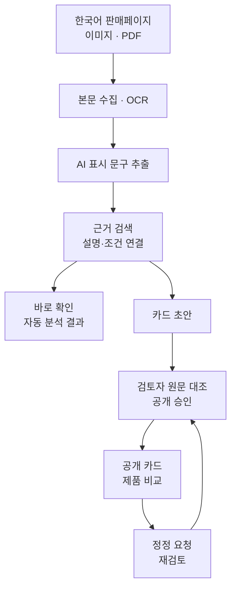

# AI 정보카드

소비자가 구매 전에 AI 기능의 근거와 사용 조건을 확인할 수 있도록 돕는 웹 서비스입니다. 한국어 판매페이지·이미지·PDF에서 ‘AI’ 표시 문구를 추출하고, 관련 설명·조건을 원문과 연결합니다.

[서비스](https://ai-infocard.co.kr/) · [주소·이미지 분석](https://ai-infocard.co.kr/check) · [제품 비교](https://ai-infocard.co.kr/compare) · [서비스 소개](https://ai-infocard.co.kr/about)

2026 AI 라이프 솔루션 챌린지 출품작 · 아이디어 챌린지 **수상 후보작** 「소비자 친화 AI 정보카드」 구현

## 주요 기능

| 기능 | 내용 |
|---|---|
| URL 분석 | 판매페이지 본문과 상세 이미지에서 AI 표시 문구·설명·사용 조건 추출 |
| 파일 분석 | 여러 장의 캡처와 PDF 입력, 긴 이미지 분할 처리 및 OCR |
| 제품 탐색·비교 | 제품명·브랜드 검색, 같은 품목의 두 제품을 공통 질문별로 비교 |
| 검토·승인·정정 | 초안 생성 → 검토자 원문 대조 → 공개 승인 → 정정·재검토 |
| 읽기 지원 | 쉬운 말·큰 글씨·읽어주기·색상 및 문자 범례 |

‘바로 확인’에서는 자동 분석 결과를 제공하고, 제품 카드는 검토자의 승인을 거쳐 공개합니다. 원문에서 설명을 찾지 못한 상태를 기능 부재로 단정하거나, 제품의 우열·위법 여부를 판정하지 않습니다.

## 구현 구조



| 단계 | 구현 |
|---|---|
| 수집 | 본문·렌더링된 페이지·상세 이미지 수집, 이미지·스캔 PDF 문자 인식 |
| 추출·연결 | 외부 AI 모델과 규칙 기반 처리, 한국어 문자 2-gram BM25 근거 검색 |
| 응답 검증 | JSON 형식, 인용문과 원문의 일치 여부, 근거 번호, 사용 조건 검사 |
| 비교 | 조건·데이터·해제·안전·피해구제에 관한 공통 질문별 정보 구성 |
| 공개 관리 | 검토자의 원문 대조·공공 DB 확인·승인 및 정정 기록 관리 |

모델 호출이나 응답 처리에 실패하면 규칙 기반 처리로 보완합니다. 쇼핑몰의 자동 접속 제한이나 이미지 해상도에 따라 읽을 수 있는 자료의 범위가 달라집니다. 자료가 부족하면 캡처·PDF를 입력하거나 확인을 요청할 수 있습니다.

**기술 스택:** Python · FastAPI · Jinja2 · SQLite · BM25 · PyMuPDF · Pillow · Playwright · 외부 AI 모델 · Render

## 검증 결과

| 구분 | 결과 | 평가 범위 |
|---|---|---|
| 공개 카드 | **228장 · 27개 품목** | 기존 집계 기준. 최신 집계는 서비스에 표시 |
| 개발 자료 조건 표시 | **70.8% → 95.8%** (34/48 → 46/48) | 동일한 문구 48개·기준 답안·저장된 AI 응답을 사용해 코드 보완 전후 비교 |
| 별도 제공 라벨 대조 | 근거 상태 **82.8%** (48/58), 조건 표시 **89.1%** (41/46) | 개발 자료와 다른 표본 사용. 표본 구성과 라벨 작성 과정의 확인 범위는 아래 기록 참조 |
| 소비자 사용성 시험 | **6명**, 평균적으로 찾은 정보 수 **2.8 → 4.3개**, 소요 시간 **197 → 85초** | 판매페이지와 카드에서 동일한 다섯 가지 정보를 찾는 소규모 비교 시험 |

95.8%는 개발 자료의 **조건 표시 일치율**입니다. 임의의 새 제품·주소에 대한 정확도와 구분합니다. [시험 방법](https://ai-infocard.co.kr/about#research-summary-title) · [평가 자료](eval/)

<details>
<summary><b>평가 표본·과거 결과·해석 범위 자세히 보기</b></summary>

### 기존 집계와 평가 기록 (2026-10-19 기록 · 최신 공개 집계는 [서비스](https://ai-infocard.co.kr/) 참조)

| 항목 | 수치 |
|---|---|
| 공개 카드 | 228장 · 27개 품목 (‘AI’를 내세우지 않는 대조군 포함) |
| 확인한 ‘AI’ 표시 문구 | 1,139개 (작동 설명 연결 877개) |
| 공개 자료에서 AI 기능 해제 방법을 확인하지 못한 제품 | 182 / 228 |
| 5차 제공 라벨 대조 | 제조사 2곳의 제품 10개에서 추출한 문구 68개 중 10개 제외, 근거 상태 일치 **82.8%(48/58)** · 조건 표시 **89.1%(41/46)** |
| 이전 4차 자동 판정 정확도 | 고정한 4차 시험의 제품 9개·문구 56개(동일 모델 1개 포함) 대상 **71.4%** (95% CI 58~82) |
| 이전 시험 정답 라벨 | 독립 라벨러 3인의 블라인드 평가·다수결, Fleiss κ 0.92 — 라벨링 4라운드 반복 (`eval/heldout*/`) |
| 소비자 사용성 시험 | 6명(60대 포함): 찾은 정보 수 2.8→4.3개, 소요 시간 197→85초 (`eval/usability/`) |
| 확장 세트 | 제조사 2곳(LG·삼성)의 제품 10개·문구 68개: 사전 등록 기록 보존, 제공 라벨과의 대조 결과 별도 추가 (`eval/heldout7/result_20261015.txt`) |

5차 대조 표본은 ‘설명 있음’ 53건·‘설명 없음’ 5건이며, 자동 분석 시스템은 ‘설명 없음’ 5건 중 3건을 잘못 분류했습니다. 모든 문구를 ‘설명 있음’으로 분류할 때의 일치율은 91.4%(53/58)입니다. 따라서 82.8%만으로 분류 성능을 평가할 수 없으며, 이 대조에서는 라벨 작성 과정의 독립성을 별도로 검증하지 않았습니다. 4차 시험의 정확도 71.4%(40/56)는 2026-10-11에 고정한 이전 결과로, 서로 다른 표본 간 수치 차이를 개선율로 해석하지 않습니다.

</details>

## 코드 구성

| 경로 | 역할 |
|---|---|
| [app/main.py](app/main.py) | 웹 요청, 분석·카드·비교·검토 화면 |
| [app/pipeline/](app/pipeline/) | 자료 수집, OCR, 문구 추출, 근거 검색·연결 |
| [app/product_lookup.py](app/product_lookup.py) · [product_identity.py](app/product_identity.py) | 기존 카드 검색·제품 식별 |
| [app/alternative_sources.py](app/alternative_sources.py) | 대체 출처 탐색 |
| [app/network_safety.py](app/network_safety.py) · [upload_safety.py](app/upload_safety.py) | 외부 주소·파일 검사 |
| [app/templates/](app/templates/) · [app/static/](app/static/) | 화면·스타일·클라이언트 동작 |
| [tests/](tests/) | 기능별 회귀시험 |
| [eval/](eval/) | 연구 평가·사용성 시험 자료와 결과 |

## 로컬 실행

Windows에서는 `run_windows.bat`를 실행합니다. 첫 실행 시 생성되는 `.env` 파일을 저장한 뒤 `run_windows.bat`를 다시 실행합니다. 기본 설정은 외부 모델을 호출하지 않는 규칙 모드입니다.

macOS·Linux:

```bash
git clone https://github.com/qutesophie-brilliant/aicard.git
cd aicard
python -m venv .venv
source .venv/bin/activate
pip install -r requirements.txt
cp .env.example .env
python seed.py
uvicorn app.main:app --reload --port 8000
```

`seed.py`는 로컬 시연용 가상 제품 2건을 등록합니다. 실행 후 [localhost:8000](http://127.0.0.1:8000)에 접속합니다.

## 환경 설정

[.env.example](.env.example)을 기준으로 설정합니다. 외부 AI 모델을 사용하려면 API 키를 입력하고 `LLM_PROVIDER`를 해당 공급자로 지정합니다.

| 변수 | 설정 |
|---|---|
| `LLM_PROVIDER` | `rules` · `gemini` · `anthropic` · `openai` |
| `GEMINI_API_KEY` · `ANTHROPIC_API_KEY` · `OPENAI_API_KEY` | 사용할 공급자의 API 키 |
| `GEMINI_MODEL` | 계정에서 사용할 수 있는 Gemini 모델명 |
| `CHECK_OCR_LLM` | `1`: 바로 확인에서 외부 AI 문자 인식 사용 |
| `CHECK_LLM` | `1`: 바로 확인에서 모델 기반 문구 연결 사용 |
| `REVIEW_TOKEN` | 공개 배포 시 필수. 검토자 화면을 보호하는 길고 고유한 값 |
| `AICARD_DB` | SQLite 파일 경로. 운영 배포 시 영속 디스크 경로 지정 |

예제 설정은 `LLM_PROVIDER=rules`, `CHECK_OCR_LLM=0`, `CHECK_LLM=0`입니다. 로컬 OCR은 Tesseract 등 설치된 OCR 도구에 따라 동작합니다. 외부 AI 문자 인식을 사용하면 이미지가 모델 공급자에게 전송되며, 모델 호출 비용이 발생할 수 있습니다. API 키와 검토 토큰은 Git에 커밋하지 않습니다.

## 테스트·평가

```bash
python -m unittest discover -s tests -v
python eval/evaluate.py claims_labels.csv --out eval/result.md
python eval/evaluate.py claims_labels.csv --use-reviewer
```

- 회귀시험과 연구 평가셋을 분리해 관리합니다. API 응답·주소 검증 시험에는 모의 응답을 사용합니다.
- 평가 CSV는 `/export/claims.csv`에서 내보낸 뒤 `gold_status`, `gold_evidence_quote`를 작성합니다.
- 라운드별 자료는 `eval/heldout3`~`eval/heldout7`, 사용성 자료는 `eval/usability/`에 있습니다. 고정한 예측·평가 결과는 코드 수정 후에도 보존합니다.

## 운영

Render 시작 명령:

```bash
uvicorn app.main:app --host 0.0.0.0 --port $PORT
```

환경 변수에 모델 설정·`REVIEW_TOKEN`·영속 디스크의 `AICARD_DB` 경로를 지정합니다. `/new`에서 초안을 생성하고, `/review/{id}`에서 원문·조건·공공 DB 조회 내용을 확인한 뒤 공개를 승인합니다.

외부 주소에서 자료를 수집할 때는 공개 IP 여부·리디렉션 대상·TLS 인증서·응답 크기를 검사합니다. 파일 업로드 시에는 실제 파일 형식·크기·PDF 내부 실행 요소를 검사합니다. 이 파일 검사는 범용 백신 검사를 대체하지 않습니다.
